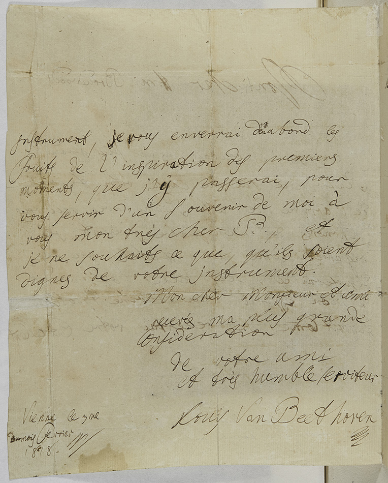

# bBsoundboard

2026 年 10 月，我们开始重新思考 bBpiano 的音板：能否不再依赖人为设计的共振，而是从音板的几何、材料与结构出发，让它自己发出声音？

从 MAESSTRO 的模态研究，到重建音板、计算振动，再到引入 Plath 的真实琴桥加速度的数据集，通过 Rayleigh 积分将结构振动转化为声压，我们终于走通了这条道路。

**2026 年 10 月 12 日，凌晨 1:33，我第一次听到了它的声音。**

B♭2、A4、C6。它还远不是一架真正的 Steinway，物理模型也远未完善，但那确实是近似钢琴的声音。

bBsoundboard 就从这里开始。希望未来它能够成为一个独立、模块化的音板物理建模框架：自由设计与组装音板，计算结构模态，提取机械与声学响应，并最终成为 bBsonic 的重要组成部分。

<h3 align="center">
  <strong>“我从未感受过比得知这架钢琴即将到来更大的喜悦。”</strong>
</h3>

  Ludwig van Beethoven · 致 Thomas Broadwood · 1818.02.03

  

  University of St Andrews · Special Collections · ms39022

  <strong>bBsoundboard</strong> · An independent component of <strong>bBsonic</strong>

